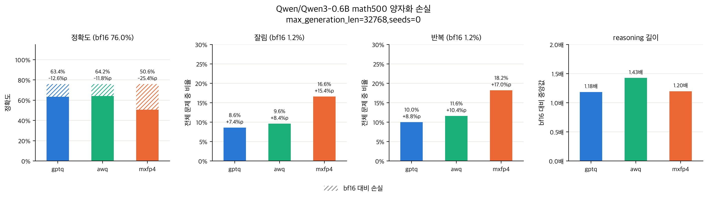
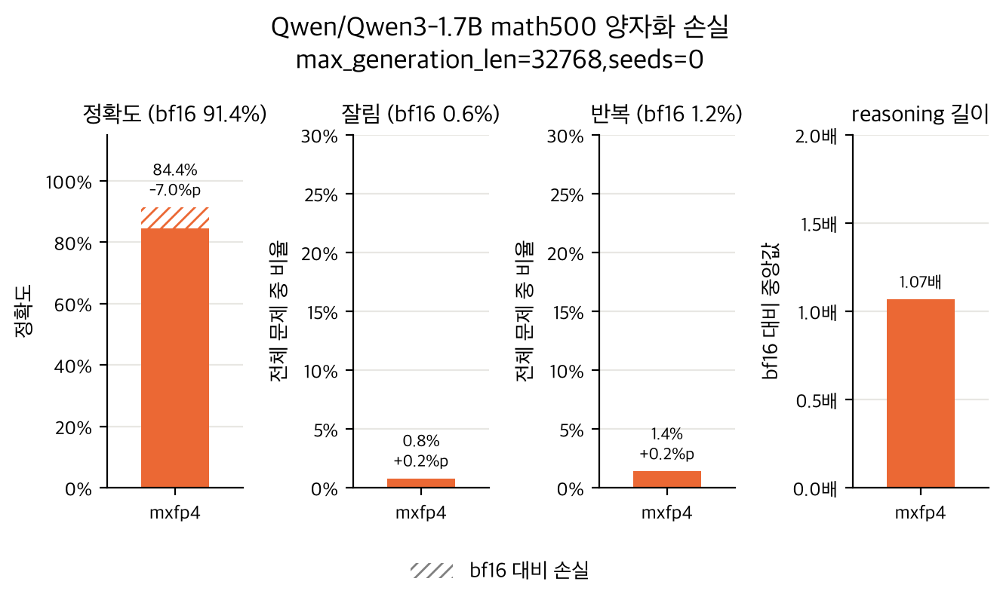
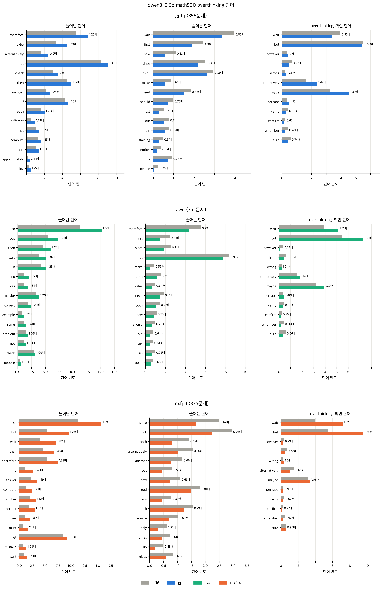
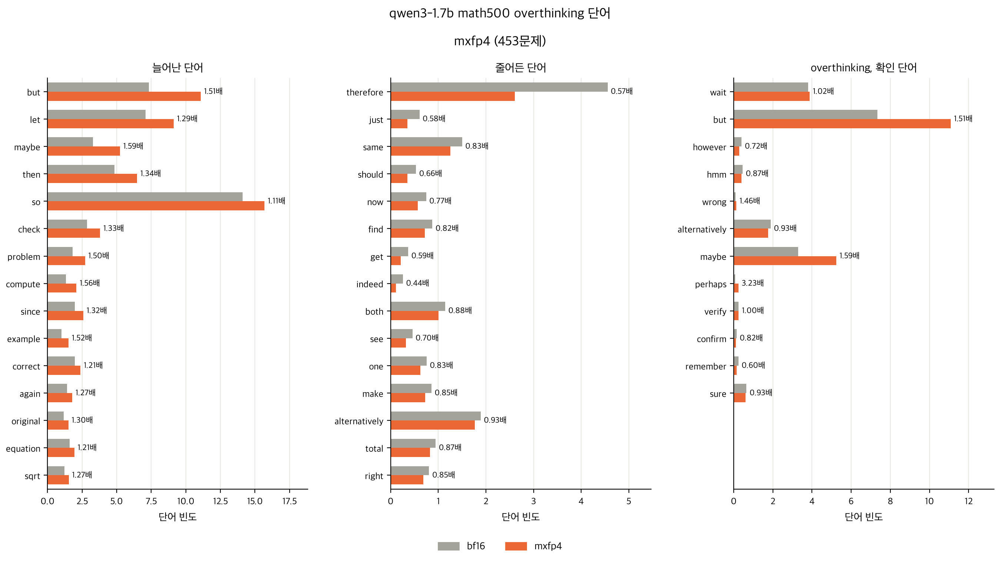
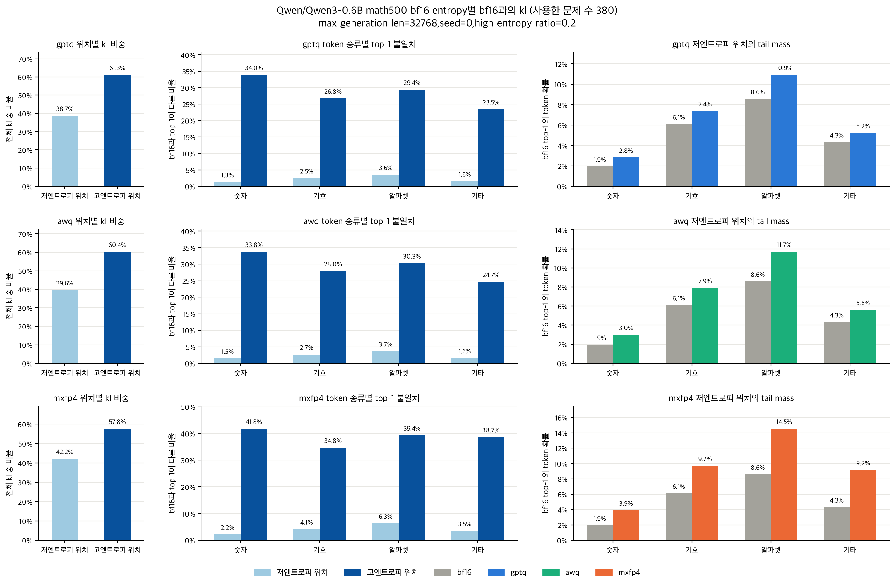
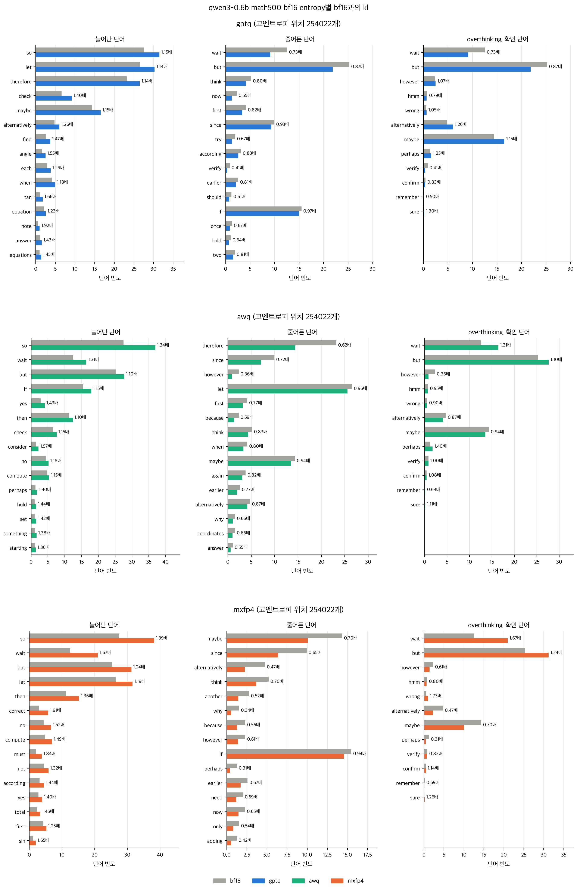
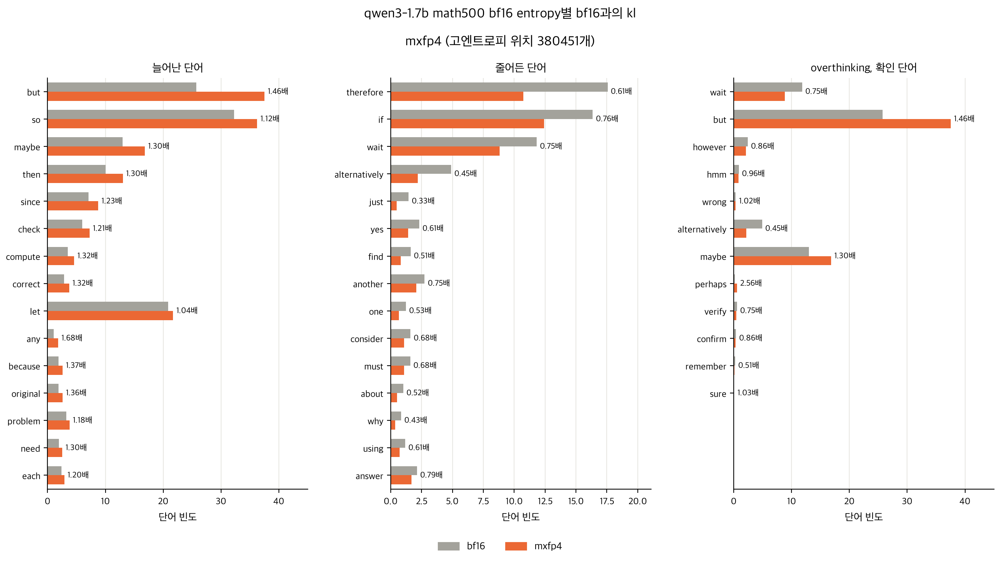
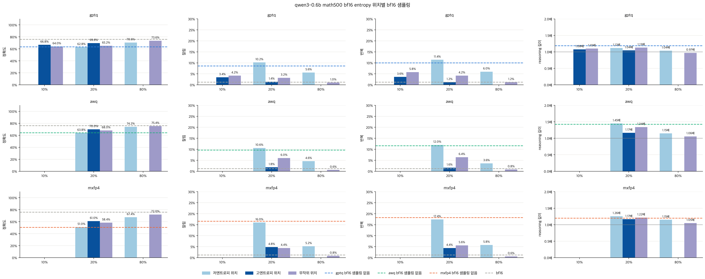

# high-low entropy quantization

## 배경
- [quantized reasoning models think they need to think longer, but they do not](https://arxiv.org/abs/2606.00206)는 양자화 모델이 고엔트로피 위치에서 bf16과 가장 많이 달라진다고 보고
- [reqat](https://arxiv.org/abs/2606.15682)는 양자화 손실이 저엔트로피 위치에서 생긴다고 보고
- 두 논문이 양자화 손실이 생기는 위치를 반대로 보아, 같은 모델과 양자화 방법에서 직접 비교

## 요약
- [양자화 손실](#양자화-손실): 양자화하면 얼마나 잃는지 → qwen3-0.6b는 모든 양자화 방법에서 크게 잃고, 잘림과 반복도 늘어남
  - [overthinking 단어](#overthinking-단어): 양자화 모델이 overthinking 단어를 더 쓰는지 → 양자화 방법과 모델마다 다름
- [bf16 entropy별 bf16과의 kl](#bf16-entropy별-bf16과의-kl): 양자화 모델의 예측이 어느 위치에서 bf16과 달라지는지 → 주로 고엔트로피 위치
- [bf16 entropy 위치별 bf16 샘플링](#bf16-entropy-위치별-bf16-샘플링): 같은 비율이면 어느 위치를 bf16 샘플링할 때 더 회복되는지 → 고엔트로피 위치

## 한계
- 모델은 qwen3-0.6b와 qwen3-1.7b, 벤치마크는 math500만 사용
- seed 0 한 번만 생성
- reqat의 bf16 샘플링은 r1-qwen-14b mxfp4로, 이 프로젝트의 모델보다 큼
- reqat는 bf16 샘플링 실험의 벤치마크를 밝히지 않아 직접 비교하기 어려움

## 관련 연구
#### [quantized reasoning models think they need to think longer, but they do not](https://arxiv.org/abs/2606.00206)
- 양자화 모델이 고엔트로피 위치에서 bf16과 가장 많이 달라진다고 보고
- 양자화 모델이 overthinking 단어를 더 골라 reasoning이 길어진다고 보고
- 이 프로젝트는 같은 모델에서 위치별 차이와 overthinking 단어를 다시 확인
#### [reqat: achieving full-precision reasoning accuracy with 4-bit floating-point quantization-aware training](https://arxiv.org/abs/2606.15682)
- fp4 양자화 손실이 숫자, 연산자 같은 저엔트로피 위치에서 생긴다고 보고
- 저엔트로피 위치를 bf16 샘플링하면 고엔트로피 위치보다 더 회복된다고 보고
- 이 프로젝트는 같은 비율의 고엔트로피 위치, 저엔트로피 위치, 무작위 위치끼리 비교

## 공통 설정
- 각 실험의 설정에 따로 적지 않으면 아래 값을 사용
#### 용어
- bf16: 양자화하지 않은 원래 모델
- reasoning: thinking mode에서 쓴 text
- response: reasoning 뒤 text
- 손실: bf16 정확도에서 양자화 모델 정확도를 뺀 값
- bf16 entropy: bf16이 예측한 다음 token 분포의 entropy
- 고엔트로피 위치, 저엔트로피 위치: bf16 entropy가 높은, 낮은 reasoning token 위치
- bf16 샘플링: 양자화 모델로 생성하면서, 일부 위치에서만 같은 문맥의 bf16 다음 token 분포로 샘플링
- 잘림: 최대 생성 길이에 닿고 틀린 문제
- 반복: reasoning 또는 response 끝에서 200~150번째 글자 50개가 그 앞에 5번 이상 나오는 문제
- reasoning 길이: bf16과 양자화 모델이 모두 맞힌 문제에서, 문제마다 bf16 대비 reasoning token 수 배의 중앙값
- overthinking 단어: wait, but, however, hmm, wrong, alternatively, maybe, perhaps
- 확인 단어: verify, confirm, remember, sure
- 단어 빈도: 1000 token당 그 단어가 나온 횟수
- 늘어난 단어, 줄어든 단어: 양자화 모델과 bf16의 단어 빈도 차이가 가장 큰 15개
#### 모델
- qwen3-0.6b와 qwen3-1.7b, thinking mode를 켜고 bf16과 비교
- transformer layer의 linear weight만 4 bit로 양자화
- 양자화 방법은 qwen3-0.6b에서 gptq, awq, mxfp4, qwen3-1.7b에서 mxfp4
- group size는 gptq와 awq 128, mxfp4 32
- gptq와 awq는 numinamath-1.5 128문제에 bf16이 최대 2048 token까지 쓴 reasoning으로 calibration
#### 생성
- vllm 0.30.0, temperature 0.6, top-p 0.95, top-k 20, 최대 생성 길이 32768
- seed 0 한 번
#### 평가
- math500 500문제, 답을 `\boxed{}`에 쓰라는 instruction으로 zero shot
- response만 채점, math-verify로 정답과 수식 비교

## 실험

### 양자화 손실
- 두 논문의 주장을 비교하기 전에, 양자화가 qwen3의 math500 정확도와 reasoning을 얼마나 바꾸는지 확인
- bf16과 양자화 모델로 math500을 풀고 정확도, 잘림, 반복, reasoning 길이 비교
#### 결과

- qwen3-0.6b에서, 모든 양자화 방법이 크게 잃고 mxfp4가 가장 많이 잃음
- qwen3-0.6b에서, 잘림과 반복이 함께 늘고 맞힌 문제에서도 reasoning이 길어짐
- qwen3-1.7b mxfp4는 손실이 더 작고 잘림과 반복이 거의 늘지 않음
- 따라서 양자화는 qwen3-0.6b에서 정확도뿐 아니라 reasoning도 크게 바꿈

### overthinking 단어
- [양자화 손실](#양자화-손실)에서 reasoning이 길어져, [quantized reasoning models think they need to think longer, but they do not](https://arxiv.org/abs/2606.00206)처럼 overthinking 단어가 늘어나는지 확인
- bf16과 양자화 모델의 reasoning에서 단어 빈도 비교
#### 설정
- 문제는 bf16이 맞히고 양자화 모델이 잘리지 않은 문제만
- 단어 빈도는 문제마다 reasoning에서 세어 평균
#### 결과

- overthinking 단어가 늘어나는지는 양자화 방법과 모델마다 다름
- wait는 gptq에서 줄고 awq와 mxfp4에서 늘어남
- 확인 단어는 대부분 줄어듦
- 따라서 reasoning이 길어지는 것은 overthinking 단어만으로 설명되지 않음

### bf16 entropy별 bf16과의 kl
- 두 논문이 가리킨 위치 중, 양자화 모델의 예측이 실제로 bf16과 달라지는 쪽 확인
- 같은 bf16 reasoning을 두 모델에 넣고, reasoning token마다 다음 token 예측 비교
#### 설정
- kl: 같은 위치에서 다음 token 예측을 bf16과 비교한 kl divergence
- kl 비중: 전체 kl 중 그 위치들의 kl 합 비율
- top-1 불일치: bf16과 양자화 모델의 top-1 token이 다른 위치 비율
- tail mass: 다음 token 분포에서 bf16 top-1 token이 아닌 token의 확률
- token 종류: 다음 token이 숫자, 기호, 알파벳, 기타 중 무엇인지
- 고엔트로피 위치는 bf16 entropy 상위 20%, 나머지는 저엔트로피 위치
- 단어 빈도는 고엔트로피 위치 1000개당 top-1 token이 그 단어인 횟수
- 문제는 bf16이 맞힌 문제만
#### 결과

- 모든 양자화 방법에서, kl 비중과 top-1 불일치가 고엔트로피 위치에 몰림
- 저엔트로피 위치에서 숫자의 tail mass가 늘어나지만, 다른 token 종류도 함께 늘어남
- 고엔트로피 위치의 top-1에서도, overthinking 단어가 늘어나는지는 양자화 방법과 모델마다 다름
- 따라서 양자화는 주로 고엔트로피 위치의 예측을 바꿈

### bf16 entropy 위치별 bf16 샘플링
- [bf16 entropy별 bf16과의 kl](#bf16-entropy별-bf16과의-kl)에서, 양자화는 주로 고엔트로피 위치의 예측을 바꿈
- 그러나 [reqat](https://arxiv.org/abs/2606.15682)는 저엔트로피 위치를 bf16 샘플링할 때 더 회복된다고 보고해, 같은 비율이면 어느 위치가 더 회복되는지 확인
- 고엔트로피 위치, 저엔트로피 위치, 무작위 위치를 같은 비율만큼 bf16 샘플링하고 정확도 비교
#### 설정
- 비율: bf16 샘플링하는 위치의 비율, 그림의 x축 눈금
- 위치 경계는 bf16 reasoning에서 잰 bf16 entropy의 분위수로 미리 정함
- 무작위 위치는 token마다 비율만큼의 확률로 고름
- 저엔트로피 위치 80%는 reqat가 저엔트로피 위치 약 75%를 bf16 샘플링한 것에 맞춤
#### 결과

- 모든 양자화 방법에서, 같은 비율이면 고엔트로피 위치를 bf16 샘플링할 때 가장 많이 회복됨
- 저엔트로피 위치 20%는 거의 회복되지 않음
- 저엔트로피 위치 80%는 많이 회복되지만, 같은 비율의 무작위 위치보다 덜 회복됨
- 따라서 이 설정에서는 저엔트로피 위치보다 고엔트로피 위치가 양자화 손실을 더 잘 설명함
