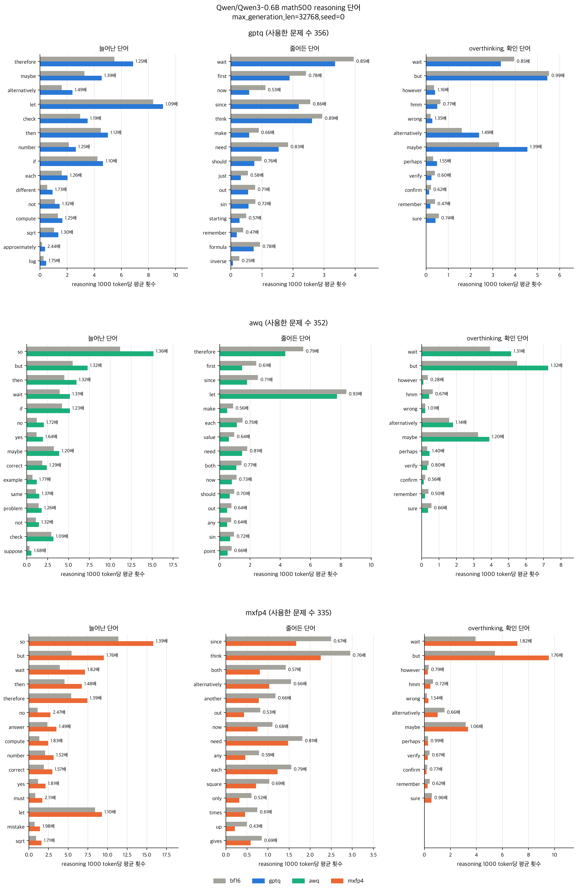
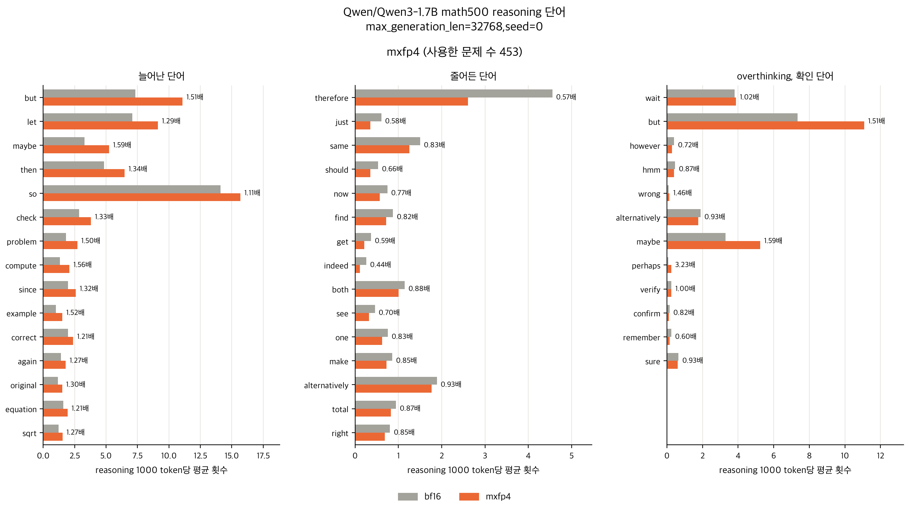
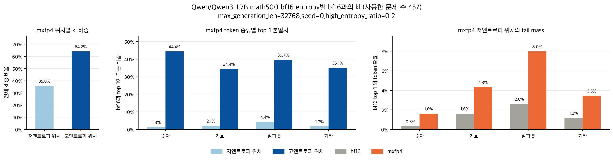
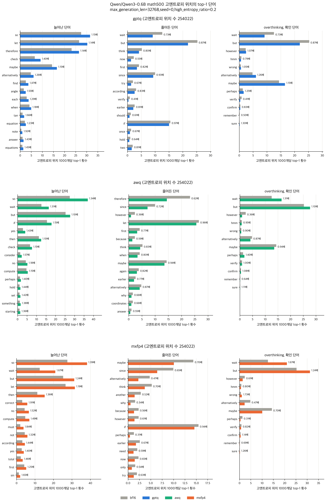
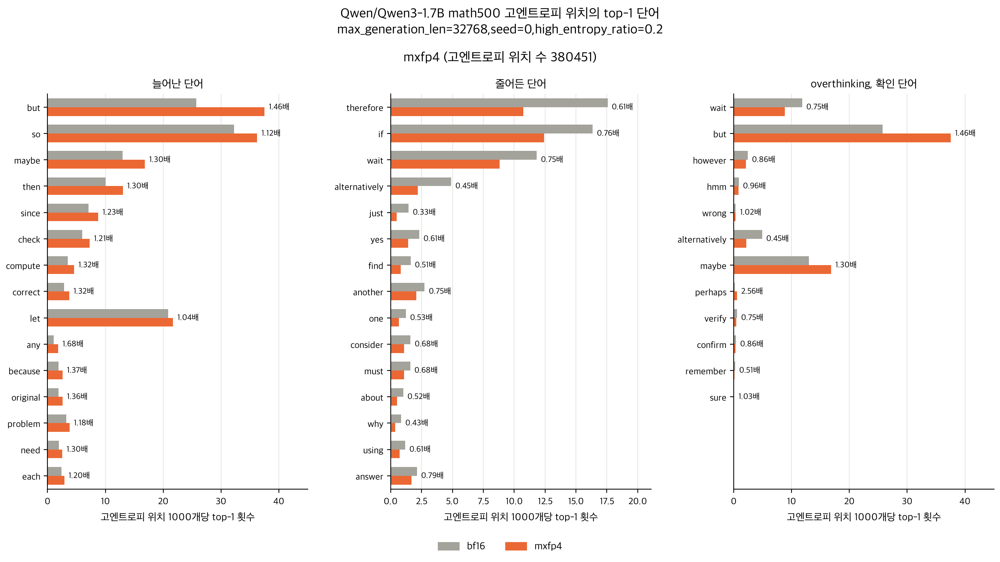
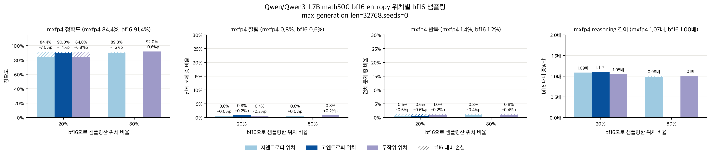

# high-low entropy quantization

## 배경

[meta 논문](https://arxiv.org/abs/2606.00206)은 양자화 모델이 다음 token이 불확실한 고엔트로피 위치에서 bf16과 가장 많이 달라지고, 거기서 wait 같은 overthinking 단어를 더 골라 reasoning이 길어진다고 보고한다. 반면 [reqat](https://arxiv.org/abs/2606.15682)는 fp4 양자화의 실패가 숫자, 연산자처럼 정확히 하나를 골라야 하는 저엔트로피 위치에 모이고, 거기서 잘못 샘플링된 token이 reasoning 전체로 퍼진다고 보고한다. 두 논문이 양자화 손실의 원인으로 서로 반대쪽 위치를 가리키기 때문에, 같은 모델과 양자화 방법에서 두 주장을 직접 비교한다.

## 요약
- qwen3-0.6b를 양자화하면 정확도가 크게 떨어지고, 잘림과 반복이 늘고 reasoning이 길어짐
- 양자화는 주로 고엔트로피 위치의 예측을 바꿈, 저엔트로피 위치의 숫자 tail mass도 늘어나지만 그 크기는 작음
- 같은 비율이면 고엔트로피 위치를 bf16으로 샘플링할 때 정확도가 가장 많이 회복되고, 저엔트로피 위치 20%는 거의 회복되지 않음
- 따라서 이 설정에서는 저엔트로피 위치보다 고엔트로피 위치가 양자화 손실을 더 잘 설명함

## 한계
- 모델은 qwen3-0.6b와 qwen3-1.7b, 벤치마크는 math500만 사용
- 생성 비용 때문에 seed 0 한 번만 돌려, seed 노이즈를 모름
- reqat와 모델이 다르고, 해당 논문은 3.2절 bf16 샘플링의 벤치마크를 밝히지 않아 직접 비교는 어려움

## 관련 연구

#### [quantized reasoning models think they need to think longer, but they do not](https://arxiv.org/abs/2606.00206)
- 양자화 모델이 고엔트로피 위치에서 bf16과 가장 많이 달라지고, overthinking 단어를 더 골라 reasoning이 길어진다고 보고
- 이 프로젝트는 위치별 차이와 overthinking 단어를 다시 확인하고, 고엔트로피 위치만 bf16으로 샘플링해 정확도까지 회복되는지 봄

#### [reqat: achieving full-precision reasoning accuracy with 4-bit floating-point quantization-aware training](https://arxiv.org/abs/2606.15682)
- fp4 양자화의 실패가 숫자, 연산자 같은 저엔트로피 위치에 모인다고 보고하고, 이를 줄이는 qat를 제안
- 이 프로젝트는 해당 논문 3.2절의 bf16 entropy 위치별 bf16 샘플링을 재현하고, 같은 비율의 고엔트로피, 저엔트로피, 무작위 위치끼리 비교

## 실험

### 공통 설정

#### 용어
- reasoning: thinking mode에서 쓴 텍스트
- response: reasoning 뒤 텍스트
- 손실: bf16 정확도에서 양자화 모델 정확도를 뺀 값
- bf16 entropy: bf16이 예측한 다음 token 분포의 entropy
- 고엔트로피 위치, 저엔트로피 위치: bf16 entropy가 높은, 낮은 reasoning token 위치

#### 모델
- 모델은 qwen3-0.6b와 qwen3-1.7b, thinking mode를 켜고 bf16과 비교
- 양자화 방법은 qwen3-0.6b에서 gptq, awq, mxfp4, qwen3-1.7b에서 mxfp4
- 양자화는 transformer layer의 linear weight만 4 bit로, group size는 gptq와 awq 128, mxfp4 32
- gptq와 awq는 numinamath-1.5 128문제에 bf16이 최대 2048 token까지 쓴 reasoning으로 calibration

#### 생성
- vllm 0.30.0, temperature 0.6, top-p 0.95, top-k 20, 최대 생성 길이 32768
- seed 0 한 번

#### 평가
- 벤치마크는 math500 500문제, 답을 `\boxed{}`에 쓰라는 instruction으로 zero shot
- 채점은 response만, math-verify로 정답과 비교

### 양자화 손실

두 논문의 주장을 비교하기 전에, 양자화가 qwen3의 math500 정확도와 reasoning을 얼마나 바꾸는지 먼저 확인한다.

bf16과 양자화 모델로 math500을 풀고 정확도를 비교한다. 양자화 모델의 reasoning이 길어지는지 보려고 잘림, 반복, reasoning 길이도 잰다. [meta 논문](https://arxiv.org/abs/2606.00206)이 말한 overthinking 단어가 늘어나는지도 보려고, reasoning의 단어 빈도를 bf16과 비교한다.

#### 설정
- 잘림: 최대 생성 길이에 닿고 틀린 문제
- 반복: reasoning 또는 response 끝에서 200~150번째 글자 50개가 그 앞에 5번 이상 나오는 문제
- reasoning 길이: bf16과 양자화 모델이 모두 맞힌 문제에서, bf16 대비 reasoning token 수 비율의 중앙값
- overthinking 단어: wait, but, however, hmm, wrong, alternatively, maybe, perhaps
- 확인 단어: verify, confirm, remember, sure
- 단어 빈도는 bf16이 맞히고 양자화 모델이 잘리지 않은 문제만 사용

#### 요약

- **qwen3-0.6b에서, 모든 양자화 방법이 정확도를 크게 잃고 mxfp4가 가장 많이 잃음**
- 잘림과 반복이 함께 늘고, 맞힌 문제에서도 reasoning이 길어짐
- qwen3-1.7b mxfp4는 손실이 더 작고, 잘림과 반복은 거의 늘지 않음
- **overthinking 단어가 늘어나는지는 양자화 방법과 모델마다 다름** (wait는 gptq에서 줄고 awq와 mxfp4에서 늘어남)
- 확인 단어는 대부분 줄어듦

### bf16 entropy별 bf16과의 kl

두 논문은 양자화가 바꾸는 위치를 서로 다르게 본다. reqat는 저엔트로피 위치의 숫자를, meta 논문은 고엔트로피 위치의 overthinking 단어를 가리킨다. 그래서 같은 reasoning에서 양자화 모델의 예측이 어느 위치에서 bf16과 달라지는지 확인한다.

bf16이 맞힌 문제에서 bf16이 쓴 reasoning을 bf16과 양자화 모델에 똑같이 넣고, reasoning token마다 두 모델의 다음 token 예측을 비교한다. kl이 어느 위치에 몰리는지, top-1 token이 달라지는 비율을 보고, reqat처럼 저엔트로피 위치의 tail mass도 token 종류별로 본다. 고엔트로피 위치에서 두 모델이 top-1으로 고른 단어도 센다.

#### 설정
- tail mass: 다음 token 분포에서 bf16 top-1 token 말고 다른 token의 확률
- token 종류: 예측할 token이 숫자, 기호, 알파벳, 기타 중 무엇인지
- 고엔트로피 위치는 bf16 entropy 상위 20%, 나머지는 저엔트로피 위치
- 문제는 bf16이 맞힌 문제만 사용

#### 요약

- **모든 양자화 방법에서, 고엔트로피 위치는 20%뿐이지만 kl의 절반 넘게 차지함**
- top-1 token이 달라지는 것도 token 종류와 상관없이 대부분 고엔트로피 위치에서 생김
- reqat 말대로 저엔트로피 위치에서 숫자의 tail mass가 늘어남, 그러나 늘어난 크기가 작고 다른 token 종류도 함께 늘어남
- 고엔트로피 위치의 top-1 단어에서도, overthinking 단어가 늘어나는지는 양자화 방법과 모델마다 다름

### bf16 entropy 위치별 bf16 샘플링

이제 두 주장을 직접 비교한다. [reqat](https://arxiv.org/abs/2606.15682)는 저엔트로피 위치만 bf16으로 샘플링하면 고엔트로피 위치보다 정확도가 더 많이 회복된다고 보고한다. 그래서 같은 비율이면 어느 위치를 bf16으로 샘플링할 때 손실이 더 줄어드는지 확인한다.

양자화 모델로 생성하면서, 일부 위치에서만 같은 문맥의 bf16 다음 token 분포로 샘플링한다. 위치는 bf16 entropy가 높은 위치, 낮은 위치, 무작위 위치로 고르고, 같은 비율끼리 비교한다. 경계는 bf16 reasoning에서 잰 bf16 entropy의 분위수로 미리 정한다. 저엔트로피 위치 80%는 reqat가 저엔트로피 위치 약 75%를 bf16으로 샘플링한 것에 맞춘다.

#### 설정
- bf16으로 샘플링하는 위치 비율은 20%, 80%, gptq는 10%도
- 고엔트로피 위치는 10%, 20%만

#### 요약

- **모든 양자화 방법에서, 같은 비율이면 고엔트로피 위치를 bf16으로 샘플링할 때 정확도가 가장 많이 회복됨**
- 고엔트로피 위치 20%는 잘림과 반복도 크게 줄임
- 저엔트로피 위치 20%는 거의 회복되지 않음
- 저엔트로피 위치 80%는 많이 회복되지만, 같은 비율의 무작위 위치보다 낮음
- *추측) reqat와 결과가 다른 것은 모델이나 벤치마크 차이 때문일 수 있음, 해당 논문의 다른 분석은 aime를 씀*
